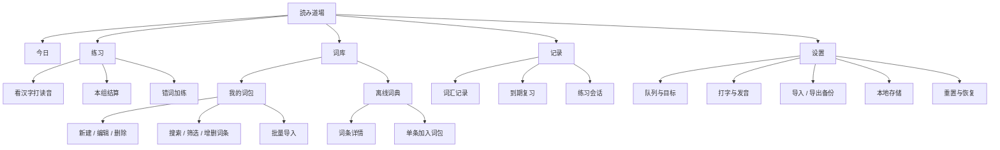
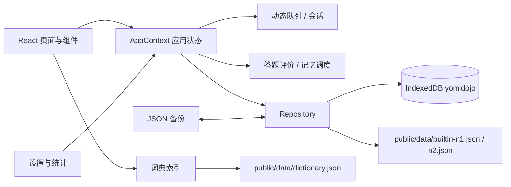

# 読み道場 / Yomi Dojo

面向单人使用的「看汉字、打读音」日语词汇训练器。项目是独立实现的静态单页应用，不复用参考网站的账号、后端、私有接口或受保护资源。

- 核心练习：从所选词包的整包范围动态生成打字任务。
- 记忆系统：记录错误率、正确率、掌握度、稳定性、复习日期和逐词历史。
- 词库能力：内置 N1 / N2 词包、自定义词包、离线词典、批量导入与单条添加。
- 数据方式：IndexedDB 本地保存；JSON 全量备份与恢复；无登录、无云端同步。
- 部署方式：React + Vite 静态构建，可通过 GitHub Actions 发布到 GitHub Pages。

详细验收状态见 [功能对照表](docs/FEATURE-MATRIX.md)，参考站分析边界见 [参考站分析](docs/REFERENCE-ANALYSIS.md)。

## 快速开始

建议使用 Node.js 22 或更新的 LTS 版本。

```powershell
npm ci
npm run dev
```

默认开发地址为 `http://127.0.0.1:4173`。生产构建与本地预览：

```powershell
npm run build
npm run preview
```

常用验证命令：

```powershell
npx tsc -b
npm test
npm run test:e2e
```

`npm run test:e2e` 会先执行生产构建，再以 `http://127.0.0.1:4184` 启动预览并运行 Playwright。

## 项目范围

### 已复刻的核心功能

参考站的「首页 → 练 → 打字 → 看汉字打读音」主流程被重建为独立实现：

1. 必须选定一个词包后才能开始练习。
2. 每组从词包整包范围动态抽取，而不是按固定分册顺序切题。
3. 打开 `/type` 时自动恢复当前词包未完成组，或直接生成下一组；不经过独立准备页。
4. 题目显示汉字、可选释义、逐音读音槽、当前组进度、速度和逐键正确率。
5. 视觉隐藏的输入框接收键盘/IME 事件，页面按单键驱动独立罗马字匹配器。
6. 支持假名和罗马字输入；`k`、`ky`、`sh` 等未成音前缀保持 pending，不判错、不推进槽位。
7. 错误只清空当前 pending 并保留已确认位置；当前槽变红、读音行抖动、错误音和震动立即反馈。
8. 按住空格、Tab 或「按住看读音」按钮显示当前词完整读音；松开立即隐藏，并记录提示使用。
9. `Esc` 或三次错误后的「跳过」按钮跳过当前词；跳过记为未一次答对，并更早安排复习。
10. 完成后自动进入下一词，或关闭自动推进后按 `Enter` / 点击「下一个词」继续；保存中不会提前推进。
11. 每组结束在同一 `/type` 路由显示用时、假名/分、正确率、最高连击和薄弱词。
12. 结算在有下一组时提供「下一组」，同时保留「第 N 组再打一遍」；没有下一组时把重打升为主按钮。内置与自定义词包都显示本组最快纪录；加练及其重打不占组号、不显示组纪录，并可只练仍可用的薄弱词。

### 保留并扩展的辅助功能

- 保留词包选择、知识库式词汇浏览、词包内搜索、词条详情和单条加入词包。
- 内置两个可随时恢复的 N1 / N2 词包。
- 支持新建、重命名、删除词包，以及添加、移除词条。
- 支持 `.xlsx`、CSV、TSV、JSON、TXT 导入和粘贴导入，导入前可校对、编辑、移除行。
- 支持搜索 30,566 条离线词典词目，并按汉字、假名、罗马字或中文释义检索。
- 支持 JSON 全量导出与恢复、存储用量查看、持久存储申请和数据重置。

### 明确不迁移

- 参考站的“句子填空”等其他练习模式。
- 参考站的语法知识库及与打字练习无关的内容模块。
- 登录、账号、会员/额度、权限管理、云端同步和跨设备数据。
- 参考站的私有 API、密钥、前端源码、视觉资源和原样文案。

## 参考站分析摘要

分析目标为 `https://jp-master.com/type`，重点限于「首页-练-打字」中的「看汉字打读音」；词包搜索、导入和单条加入能力同时参考了 `https://jp-master.com/kb`。

已在已登录浏览器中实际操作核对：

- 打字入口存在「看汉字打读音」与「句子填空」，本项目只迁移前者。
- 页面存在“我的词”、N1 高频词、N2 高频词和导入词包等词包入口。
- 打字页展示汉字、释义、读音槽，并提供按住看读音的交互。
- 页面说明包含罗马字拼写、空格提示和 `Esc` 跳过等操作方式。
- 设置中存在显示/隐藏读音、按键音、完成后发音等开关。
- 词包导入弹窗包含词包名称、逐行词条和下一步流程。
- 知识库支持词汇搜索、词条详情、加入词包，以及 JLPT 等筛选入口。

无法验证的边界：

- 参考站后端接口、账号权限、额度限制和服务端保存机制。
- 参考站精确的队列补位算法、提示计分方式、复习调度参数和错误分类。
- 参考站完整的数据许可、词典覆盖范围，以及所有异常状态。

因此，本项目复刻的是已观察、已操作验证的可见流程与业务能力；未把推测当作事实。完整说明见 [docs/REFERENCE-ANALYSIS.md](docs/REFERENCE-ANALYSIS.md)。

## 功能结构



## 核心业务流程

### 开始与生成任务

1. 首页显示当前词包、总体到期数、今日答题数、连续学习天数和词包进度。
2. 进入 `/type` 后不再显示准备页：有未完成组就恢复，有已完成且 24 小时内未关闭的结算就恢复结算，没有则自动生成一组。
3. 本组词数在设置页配置（1–200，默认 20）；变更从下一组开始生效。
4. 系统从当前词包所有“带汉字且有非空读音”的去重词条中动态选题。
5. 生成顺序为：到期复习优先 → 未学新词（受每日上限约束）→ 掌握度较低的未来词补齐。
6. 每组创建后写入该词包的 `activeSession`；刷新或切换词包后仍可继续。

### 单题判定

1. 输入会先规范化为平假名，再与目标读音及词典备选读音比较。
2. 罗马字尚未形成完整音节时视为“待定后缀”，不会误判为用户错误。
3. 长音写法 `とうきょう`、`とーきょう`、`とおきょう` 等价；`こんにちは` 也接受 `konnichiwa`。
4. 前缀正确时只提交已稳定的假名；出现错误时只清空当前 pending，不回退已确认位置。
5. 一次答对要求：没有输入错误、没有使用提示，且最终正确完成。
6. 每题记录模式、结果、错误次数、是否提示、是否跳过、耗时、输入假名数和答题时间。

### 结算、继续与跨词包

1. 一组完成后，逐词记录与组结算在同一个 IndexedDB 事务中保存。
2. 有下一组时显示「下一组」和「第 N 组再打一遍」；没有下一组时「第 N 组再打一遍」成为主按钮。
3. 内置与自定义词包都按同一组号维护最快用时，结算显示首次纪录、追平、慢了几秒或新纪录。
4. 「下一组」重新从整包动态队列规划；「第 N 组再打一遍」按本组逐题快照的原顺序重放；薄弱词加练及其重打显示「再来一组」。
5. 结算使用当组保存的词条快照，即使之后从词包移除词条，历史结果与可重打内容仍然准确。
6. 每个词包各自保存最新的未完成组；切换后回到该词包时恢复最新进度。
7. 已完成组的组号由会话历史推导；普通重打继承原组号，加练和由加练启动的重打不占用组号，也不显示组纪录。
8. 同一「单词 + 规范化读音」在不同词包之间共享错误率、掌握度和复习历史。

## 页面与交互清单

| 页面 | 主要交互 | 状态与反馈 |
| --- | --- | --- |
| 今日 | 开始/继续练习、切换词包、进入查词、查看历史 | 今日目标环、到期数、进度、7 日柱状图、最近会话、空状态 |
| 打字练习 | 假名/罗马字/IME 输入、按住提示、跳过、切换词包、调整设置 | 隐藏输入、pending、逐键正确率、连击、活动计时、自动/手动推进、保存失败重试 |
| 本组结算 | 下一组、第 N 组再打一遍、只练薄弱词、继续当前组 | 四张统计卡、最快纪录、薄弱词、重打不可用原因、生成中/空队列反馈 |
| 词库-词包 | 新建、编辑、删除、搜索、状态/来源分组筛选、增删词条 | 空词包、无筛选结果、导入进度、删除确认、进行中标记 |
| 词库-词典 | 任意检索、查看详情、朗读、加入任意词包 | 加载中、失败重试、无结果、已在词包、手动创建入口 |
| 导入向导 | 文件拖放、粘贴、表头识别、目标词包、逐行校对 | 缺读音、无汉字、重复、非法读音、警告和错误提示 |
| 记录 | 词汇筛选/排序/搜索、到期列表、会话详情、词条历史 | 学习统计、薄弱词、7 日节奏、空状态、分页加载 |
| 设置 | 队列、输入方式、音效、自动推进、备份、存储、重置 | 乐观保存、保存失败回滚、持久存储结果、危险操作确认 |

移动端在 390×844 视口下使用 52.5px 打字顶栏和 5 项底部主导航；桌面端使用 63px 全局导航与 720px 内容列。核心打字和结算流程均已适配。

## 技术架构



### 技术栈

| 层 | 方案 |
| --- | --- |
| UI | React 19 + TypeScript |
| 构建 | Vite 8，`base: "./"`，生产静态资源 |
| 路由 | Hash 路由（`#/home`、`#/library` 等），兼容 GitHub Pages 子路径 |
| 状态 | React Context + 不可变快照；设置采用乐观更新与串行落盘 |
| 持久化 | 浏览器 IndexedDB，数据库 `yomidojo` |
| 导入 | `read-excel-file` 读取 `.xlsx`；CSV/TSV/JSON/TXT 自有解析 |
| 假名处理 | `wanakana` + 项目内规范化/判定逻辑 |
| 音频 | Web Audio 合成按键音；Speech Synthesis 朗读 |
| 单元测试 | Vitest |
| 端到端测试 | Playwright + Chromium |

没有业务后端、远程数据库或账号服务。静态资源加载后，词包和学习记录都在当前浏览器中处理。

### 目录

```text
src/
  app/            应用上下文、路由
  components/     词包、词典、导入、弹窗与通用 UI
  data/           类型、IndexedDB、仓库、队列、SRS、导入器、内置词包
  hooks/          词典加载
  lib/            假名判定、音频、格式化工具
  pages/          今日、词库、记录、设置
  type/           `/type` 打字页、逐键状态机、内联面板与结算
public/data/      运行时词典与内置词包
scripts/          数据构建脚本（开发时使用）
tests/e2e/        Playwright 端到端测试
```

## 数据模型与 IndexedDB

| Store | 主键 | 内容 |
| --- | --- | --- |
| `packs` | `id` | 词包元信息与词条数组 |
| `plans` | `packId` | 当前未完成组、完成组数、最后完成时间 |
| `wordStats` | 规范化 `key` | 错误率、掌握度、稳定性、复习时间、历史 |
| `sessions` | `id` | 已完成组的逐题答案与汇总 |
| `meta` | `key` | 设置、当前词包、种子版本 |

`plans` 额外保存 `lastResultId` / `lastResultAt` 用于刷新恢复结算；会话和结算保存 `wordSnapshots`，用于在词包编辑后维持结果与重打的真实性。重打会话通过 `retryOfSessionId` 继承原组号，若父会话是加练则不获得组号或组纪录。

单词身份键为：

```text
normalizeWord(surface) + "|" + canonicalizeKana(reading)
```

因此同一词条换词包不会复制学习记录；读音写法差异也不会产生重复身份。

主要记录字段：

- `attempts`、`correctFirstTry`、`wrong`、`skipped`、`mistakes`
- `errorRate`：未一次答对的尝试占比
- `accuracy`：一次答对占比
- `streak`、`bestStreak`
- `stability`、`difficulty`、`lapses`、`mastery`
- `firstSeenAt`、`lastReviewedAt`、`dueAt`
- `history`：最近 40 条逐次结果

每个词包的未完成组保存在 `plans.activeSession`，不同词包互不覆盖。

## 动态队列与记忆调度

### 队列规则

1. 过滤无汉字、无读音词条；按词条身份去重。
2. 到期词按逾期天数、历史正确率、上次结果、连击和掌握度评分排序。
3. 新词只补剩余空位，并受“每日新词上限”约束；`0` 表示不限。
4. 新词与到期词交错插入，避免整组集中复习同一类。
5. 空位由未来到期但掌握度较低的词提前巩固。
6. 错词加练强制生成 `relearn` 队列，不受普通队列顺序影响。

### 掌握度算法

实现为确定性调度器，参考 FSRS / SM-2 的“稳定性、难度、遗忘后回退”思路，但不是经过参数训练或学习效果实验验证的正式 FSRS：

- 无错误、无提示且速度较快：高评价，提升稳定性。
- 较慢但无错误：中等评价。
- 使用提示、出现错误：降低稳定性并增加难度。
- 跳过：按失败处理，约 4 小时后再次进入到期队列。
- `mastery` 综合稳定性、一次答对率和练习次数计算。
- 掌握区间：未学（0）、学习中（<40）、渐熟（40–69）、已掌握（70–89）、长期稳定（≥90）。

该算法满足自动安排复习、错词优先、记录可解释的要求，但不能宣称等同于经实证校准的 FSRS。

## 导入格式

支持来源：

- Excel `.xlsx`
- CSV、TSV、TXT
- JSON（数组，或含 `words` / `entries` 数组）
- 直接粘贴文本
- 旧版 `.xls` 不支持，需另存为 `.xlsx` 或 CSV

支持的表头别名包括：

| 字段 | 示例 |
| --- | --- |
| 单词 | 单词、單詞、词汇、汉字、単語、word、kanji |
| 读音 | 读音、假名、发音、読み、reading、kana |
| 释义 | 释义、中文、意思、意味、meaning |
| 等级 | JLPT、等级、level |
| 分组 | 分组、单元、group、lesson |

支持一行一个词、制表符或逗号分隔；缺少读音或释义时会尝试用离线词典补全。导入前会逐行标记：

- 可导入
- 缺读音
- 无汉字
- 重复
- 需修正

可在预览中直接编辑或移除。单次最多导入 10,000 行。无汉字词可保留在词包中，但不会进入打字队列。

## 备份格式

设置页导出的 JSON 包含：

```json
{
  "format": "yomidojo-backup",
  "version": 1,
  "appVersion": "1.0.0",
  "exportedAt": "2026-11-08T00:00:00.000Z",
  "settings": {},
  "packs": [],
  "plans": [],
  "wordStats": [],
  "sessions": []
}
```

恢复会先校验格式、词包/计划/记录/会话结构，并拒绝重复标识或损坏的未完成组。校验通过后整体替换当前数据。备份文件上限为 100 MB。

浏览器本地数据可能因清理站点数据而丢失。建议在大量导入后、换设备前或定期导出备份；设置页也提供持久存储申请入口。

## GitHub Pages 部署

项目已包含 `.github/workflows/deploy.yml`：

1. 将完整项目推送到 GitHub 仓库的 `main` 分支。
2. 在仓库 `Settings → Pages → Source` 选择 **GitHub Actions**。
3. 推送后工作流会执行 `npm ci`、单元测试、生产构建，并发布 `dist`。
4. 站点地址通常为 `https://<用户名>.github.io/<仓库名>/`。

`vite.config.ts` 使用 `base: "./"`，路由使用 hash，因此项目页子路径不需要额外改写。`public/data` 必须随仓库提交；根目录 `.gitignore` 只忽略开发用的 `/data/`，不会忽略运行时数据。

本项目没有后端。GitHub Pages 只提供静态文件；每个浏览器拥有独立 IndexedDB 数据，不会在不同设备之间同步。迁移数据请使用设置页的 JSON 备份。

## 验收状态

功能级结果以 [docs/FEATURE-MATRIX.md](docs/FEATURE-MATRIX.md) 为准；当前构建的独立复核记录见 [docs/reviews/verification-r8.md](docs/reviews/verification-r8.md)。最终验收命令：

```powershell
npx tsc -b
npm test
npm run build
npm run test:e2e
npm run test:pages
```

已验证范围包括：生产构建、58 个单元测试、38 个 Playwright 场景（逐键打字/错误/提示/跳过、加练随机顺序、组纪录与重打、加练重打语义、移除词条后的结算快照、跨包删除、跨词包未完成组、保存延迟与写入失败重试、最后一词失败后的结算幂等、离线重载、结算刷新、备份与损坏备份、XLSX/JSON/TSV 导入、导入缺读音与非法读音门禁、空词包组数、词包生命周期、词典搜索与单条加入、记录详情、移动端流程），以及 GitHub Pages 子路径 `/repo/` 的离线冒烟测试（字体、Service Worker 作用域、缓存键、断网重载）。

### 已知限制

- 仅自动化验证 Chromium；其他现代浏览器依赖 IndexedDB、Web Audio 和 Speech Synthesis 的实现。
- 完成后朗读依赖设备是否安装日语语音；自动化测试不能验证真实音频输出。
- 真机 iOS/Android 输入法的 composition 事件差异未逐机型验证；桌面 Chromium 的罗马字、假名和 IME 路径已覆盖。
- 两个标签页同时写入同一词包时的跨标签页并发没有自动化覆盖；单标签页内的保存延迟、失败和重试已覆盖。
- IndexedDB 数据是站点来源隔离的；不同域名、端口或仓库路径下不会自动共享。
- 复习算法是自定义的确定性实现，未进行教育学实验或大规模学习效果校准。
- 新增的本组纪录行使结算内容相对旧参考 DOM 多约 40.5px 高度；这是保留产品功能后的已知结构差异，不是溢出。
- 参考站后端、原始算法、权限与精确评分机制无法验证，因此不宣称逐行等价。

## 数据来源与许可

- 离线词典：30,566 条常用与 JLPT 词目，衍生自 JMdict / KANJIDIC2（EDRDG）与 Tomoshi 开放数据（Y1Z），版本 `2026-11-06`，许可 **CC BY-SA 4.0**。
- 数据仓库：`tomoshi-app/tomoshi-dict-data`。
- 内置 N1 / N2 词包：项目所有者提供的 JLPT 学习词表；当前分别为 883 词 / 45 组和 789 词 / 40 组。
- 本项目未复制参考网站的私有代码、接口或受保护资源。

词典修改说明：仅保留搜索与学习所需字段，压缩字段格式，移除例句；详见 `public/data/dictionary.json` 的 `modified` 元数据。
