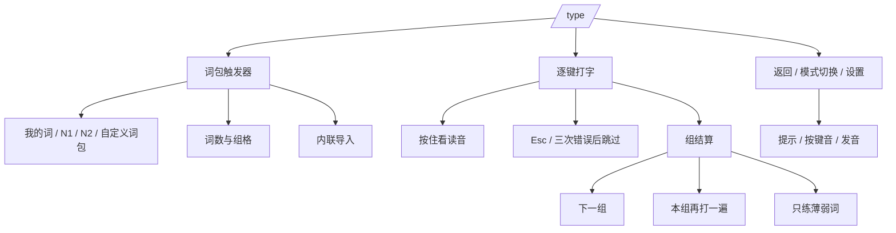

# 参考站分析与独立实现边界

## 1. 研究范围

目标为 `https://jp-master.com/type`，只覆盖：

- 首页进入打字练习的入口行为；
- 「看汉字打读音」；
- 与该模式直接相关的词包选择、导入、设置、结算；
- 为完成上述流程所需的账号状态观察。

明确排除：

- 句子填空；
- 阅读、JLPT、语法、知识库其他内容模块；
- 账号系统、会员、额度与云端数据；
- 参考站后台、管理端和数据生产管线。

## 2. 功能结构



## 3. 核心业务流程

1. 用户打开 `/type`。
2. 页面读取本地偏好、可用词包和当前词包。
3. 当前词包有未完成组时直接恢复；没有时按动态队列生成一组。
4. 页面自动聚焦隐藏输入框。
5. 每个键先进入待定缓冲，再形成可接受音节。
6. 正确字符推进；错误字符触发反馈；不完整罗马字不判错。
7. 一词完成后短暂显示结果行并立即进入下一词。
8. 全组完成后，在同一路由显示统计与薄弱词。
9. 用户可选择下一组、重打本组或只练薄弱词。
10. 每个词包独立保存未完成组；切换词包再返回时恢复。

## 4. 页面与交互清单

| 区域 | 控件 | 已验证行为 |
| --- | --- | --- |
| 全局导航 | 首页、阅读、JLPT、知识库、设置、账号 | 可点击；与打字核心无关，不迁移其他业务 |
| 打字头部 | 返回 | 回到进入练习前的页面 |
| 打字头部 | 模式胶囊 | 在“看汉字打读音/句子填空”间切换；本项目只保留前者 |
| 打字头部 | 设置齿轮 | 展开/关闭设置 |
| 词包行 | 当前词包 | 展开/折叠词包面板 |
| 词包面板 | 词包 chips | 切换词包和数据源 |
| 词包面板 | 组格 | 选择组；已完组显示成绩，当前组高亮 |
| 词包面板 | 导入词包 | 切换到内联导入 |
| 打字主体 | 汉字、释义 | 当前题信息 |
| 打字主体 | 读音槽 | 当前 / 已输入 / 错误三种状态 |
| 打字主体 | 按住看读音 | 按住显示，松开隐藏；记录提示使用 |
| 打字主体 | 跳过 | 三次错误后出现；Esc 也可跳过 |
| 进度 | 当前数/总数、速度、正确率、连击 | 实时更新 |
| 结果 | 四统计卡 | 用时、速度、准确率、最高连击 |
| 结果 | 薄弱词列表 | 打错、看提示、跳过 |
| 结果 | 下一组 / 再打一遍 / 只练这些 | 三种后续动作 |

## 5. 输入与状态变化

```text
keydown
  → 修正键 / 忽略组合键
  → 加入 pending
  → 枚举当前位置可接受拼写
      → 仍为前缀：pending 更新，不判错
      → 完整音节：确认字符，亮色 + key-pop + ring + 键音
      → 不匹配：错误计数 +1，红色 + nope + 错误音 + 震动
  → 所有字符完成
      → 保存答案与 SRS 记录
      → 显示上一词结果行
      → 立即装载下一词
```

## 6. 数据与持久化

参考站：

- 词包和组由服务端提供。
- 完成成绩通过 `PUT /api/typing/packs/:id/units/:n` 写回。
- 用户词与账号关联。

新项目：

- IndexedDB `yomidojo` 保存词包、会话、逐词记录、设置。
- 没有远程账号。
- JSON 导出/恢复用于迁移。
- 同一「单词 + 规范化读音」跨词包共享学习记录。

## 7. 与用户业务的差异

| 参考站 | 新项目 |
| --- | --- |
| 固定 20 词/组 | 每组词数可配置，默认 20 |
| 固定 unit 顺序 | 整包动态队列：到期 → 新词 → 薄弱补齐 |
| 每个 unit 独立成绩 | 每个词包保存未完成组和完成记录 |
| 完成组写服务端 | 写入本地 IndexedDB 并更新 SRS |
| 我的词由账号词库提供 | 固定「我的词」入口：有自定义词包时打开该包，无自定义词包时打开真实导入流程；内置 N1/N2 可随时恢复 |
| 私有 TTS | `speechSynthesis` |
| 私有词典预览 | 本地离线词典补读音 |

这些差异是用户明确要求，不属于功能缺失。

## 8. 不迁移内容

- 句子填空；
- 阅读器；
- JLPT 专区；
- 语法知识库；
- 账号、会员、额度；
- 云端同步与多用户；
- 参考站私有接口、源码、字体子集以外的品牌资产；
- 原站固定 unit 服务端实现。

## 9. 研究限制

无法在无副作用前提下验证的路径：

- 并发保存、跨设备同步；
- 服务端权限变化；
- 导入超大数据集；
- 所有 TTS 语音设备；
- 私有词库许可与内容更新。

因此，新项目以“独立可运行、行为等价、本地真实实现”为验收标准，不声称与参考站后端逐行一致。
